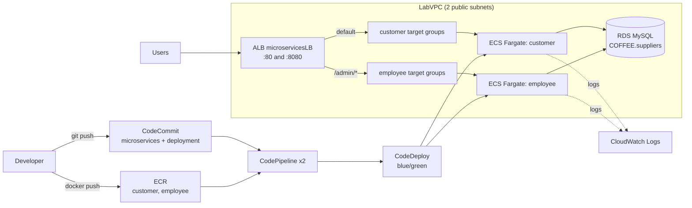

# Coffee Suppliers: Microservices + CI/CD on AWS (Terraform)

Infrastructure as Code version of the AWS Academy project "Building Microservices and a CI/CD Pipeline with AWS". A monolithic Node.js "coffee suppliers" app is split into two containerized microservices that run on ECS Fargate behind an Application Load Balancer, and are deployed by CodePipeline + CodeDeploy using blue/green deployments.

## What this builds

| Requirement | How it is met |
|---|---|
| R1 Design | Architecture diagram below |
| R2 Cost optimized | Fargate (no servers to manage), small tasks (0.5 vCPU / 1 GB), single ALB |
| R3 Microservices | `customer` (read-only) and `employee` (read-write, under `/admin`) |
| R4 Portability | Each service is a Docker image stored in ECR |
| R5 Scalability / resilience | ECS service scaling, ALB path-based routing, 2 AZs |
| R6 Automated CI/CD | CodePipeline triggered by CodeCommit and ECR changes, CodeDeploy blue/green |

### Architecture



### Routing and blue/green layout

| Listener | Default action | `/admin/*` rule |
|---|---|---|
| HTTP:80 (production) | `customer-tg-two` | `employee-tg-two` |
| HTTP:8080 (test) | `customer-tg-one` | `employee-tg-one` |

CodeDeploy shifts traffic between the "one" and "two" target groups on every deployment. Old tasks stay up for 5 minutes after a successful deployment so you can roll back.

## Prerequisites

- Terraform `>= 1.6`
- AWS CLI v2, configured for `us-east-1`
- Docker (for building and pushing images)
- Git
- An AWS account or an AWS Academy lab session

### Two ways to run it

| Mode | Use when | Settings |
|---|---|---|
| Academy lab | You are in the AWS Academy lab. `LabVPC`, `PipelineRole`, `DeployRole` and the RDS database already exist, and IAM creation is blocked | `use_existing_vpc = true`, `use_existing_iam_roles = true`, `create_rds = false` |
| Standalone | Your own AWS account | `use_existing_vpc = false`, `use_existing_iam_roles = false`, `create_rds = true` |

> Service availability: AWS has restricted CodeCommit and Cloud9 for new customers at times. Check that both are available in your account before applying. If not, the CodeCommit and Cloud9 parts need an alternative (for example a GitHub connection for the source stage).

## Repository layout

```
.
├── README.md
├── AGENT_PROMPT.md
├── Makefile
├── terraform/
│   ├── versions.tf
│   ├── providers.tf
│   ├── variables.tf
│   ├── terraform.tfvars.example
│   ├── data.tf               # lookups of existing VPC, subnets, roles, RDS
│   ├── network.tf            # optional VPC + security group
│   ├── iam.tf                # optional roles
│   ├── rds.tf                # optional database
│   ├── ecr.tf
│   ├── ecs.tf
│   ├── alb.tf
│   ├── codecommit.tf
│   ├── codedeploy.tf
│   ├── codepipeline.tf
│   ├── cloud9.tf             # optional
│   ├── cloudwatch.tf
│   ├── outputs.tf
│   └── templates/
│       ├── taskdef.json.tftpl
│       └── appspec.yaml.tftpl
├── services/
│   ├── customer/             # Dockerfile + Node.js app (read-only)
│   └── employee/             # Dockerfile + Node.js app (/admin paths)
├── deployment/               # generated: taskdef-*.json, appspec-*.yaml
└── scripts/
    ├── build_and_push.sh
    ├── push_deployment_files.sh
    └── seed_db.sh
```

### Service code (put these in place before `apply`)

Copy the final versions of your microservice code into `services/`:

- `services/customer`: only `findAll` and `findOne` in the controller, add/edit/delete routes commented out in `index.js`, listening on port **8080**.
- `services/employee`: all routes prefixed with `/admin`, views and redirects updated, listening on port **8080**.
- Each folder contains this `Dockerfile`:

```dockerfile
FROM node:11-alpine
RUN mkdir -p /usr/src/app
WORKDIR /usr/src/app
COPY . .
RUN npm install
EXPOSE 8080
CMD ["npm", "run", "start"]
```

## Configuration

Copy the example variables file and edit it:

```bash
cd terraform
cp terraform.tfvars.example terraform.tfvars
```

| Variable | Default | Description |
|---|---|---|
| `aws_region` | `us-east-1` | Region |
| `use_existing_vpc` | `true` | Look up `LabVPC` instead of creating a VPC |
| `use_existing_iam_roles` | `true` | Look up `PipelineRole` and `DeployRole` instead of creating them |
| `create_rds` | `false` | Create the MySQL database |
| `db_endpoint` | `""` | RDS endpoint when `create_rds = false` |
| `db_password` | none | Sensitive. Required when `create_rds = true` |
| `create_cloud9` | `false` | Create the `MicroservicesIDE` Cloud9 environment |
| `admin_allowed_cidr` | `""` | Restrict `/admin/*` to this CIDR, for example `203.0.113.25/32` |
| `customer_desired_count` | `1` | Number of customer tasks |

Never commit `terraform.tfvars` or state files.

## Deploy

```bash
# 1. Initialise and review
make init
make plan

# 2. Create the foundation first (ECR, log group, security group, and so on)
cd terraform && terraform apply -target=aws_ecr_repository.repo && cd ..

# 3. Build and push the container images
make push-images

# 4. Create everything else
make apply

# 5. Publish the task definition and AppSpec files to the deployment repo
make push-deploy-files
```

If a pipeline fails the very first time because the `deployment` repo was still empty, open it in the CodePipeline console and choose **Release change**.

### Outputs

After `apply`, Terraform prints the ALB DNS name, ECR repository URLs, pipeline names and the log group name.

## Verify

1. Open `http://<alb-dns>`: the customer app loads and shows a read-only suppliers list.
2. Open `http://<alb-dns>/admin/suppliers`: the employee app loads with add/edit/delete buttons (from the allowed IP if `admin_allowed_cidr` is set).
3. Open `http://<alb-dns>:8080`: the test listener serves the same apps.
4. From a different network (or with `curl` from another host), `/admin/suppliers` returns the customer "page not found" response when the IP restriction is on.
5. In **CodeDeploy**, a deployment for each group finishes with all lifecycle events succeeded.
6. Check the task logs in CloudWatch log group `awslogs-capstone`.

### Trigger a new deployment

Change something in `services/employee` (for example the navbar colour in `views/nav.html`), then:

```bash
make push-images
```

The ECR push starts `update-employee-microservice`, and CodeDeploy runs a blue/green deployment. The customer service is untouched.

### Scale a microservice independently

Set `customer_desired_count = 3` in `terraform.tfvars` and run `make apply`. Or run:

```bash
aws ecs update-service --cluster microservices-serverlesscluster \
  --service customer-microservice --desired-count 3
```

Scaling does not start the pipeline.

## Design notes

- **CodeDeploy owns the runtime state.** After the first deployment, CodeDeploy changes the ECS service task definition and the ALB listener rules. Terraform ignores those fields (`lifecycle { ignore_changes }`), otherwise every `plan` would show drift and `apply` could break a live deployment.
- **Image placeholders.** The task definition files in the `deployment` repo contain the literal `<IMAGE1_NAME>`. The pipeline replaces it with the image from the ECR source action at deploy time.
- **Artifact format.** The CodeCommit source action uses the default zipped output (not full clone), so the Deploy action can find `taskdef-*.json` and `appspec-*.yaml`.
- **Keep the deployment repo small.** It should contain only the four deployment files.
- **Public subnets.** Tasks have public IPs and no NAT gateway, which keeps cost low but is not a production security posture.

## Troubleshooting

| Symptom | Likely cause |
|---|---|
| "Invalid action configuration / task definition file is missing" | Deploy action lacks `SourceArtifact` as an input, wrong file path, files not on `dev`, or the source action uses full clone |
| "Primary task group must be behind listener" | A target group is no longer attached to the ALB. Re-attach through the listener rules |
| ECS: "unable to consistently start tasks" | Target groups not attached, wrong image, or DB endpoint unreachable. Check CloudWatch logs |
| Suppliers do not load | Wrong `APP_DB_HOST`, or tasks cannot reach RDS on port 3306 |
| `terraform plan` shows changes on listeners or services after a deployment | A missing `ignore_changes` entry |
| ALB returns 503 right after apply | No healthy targets yet. Wait for the first deployment to finish |

## Clean up

```bash
make destroy
```

Fargate tasks, the ALB and RDS cost money while they exist. ECR repos and the pipeline artifact bucket are configured with force-delete so destroy can remove them. In the Academy lab, remember to choose **End Lab** when you stop working.

## Rubric mapping (for your presentation)

- Architecture diagram: Mermaid diagram above, plus your Lucidchart version.
- Cost estimate: AWS Pricing Calculator (us-east-1, 12 months).
- Evidence: screenshots of `terraform plan`/`apply`, the CodeDeploy deployment, ALB listener rules, ECS tasks, and the `/admin` access test from two IPs.
